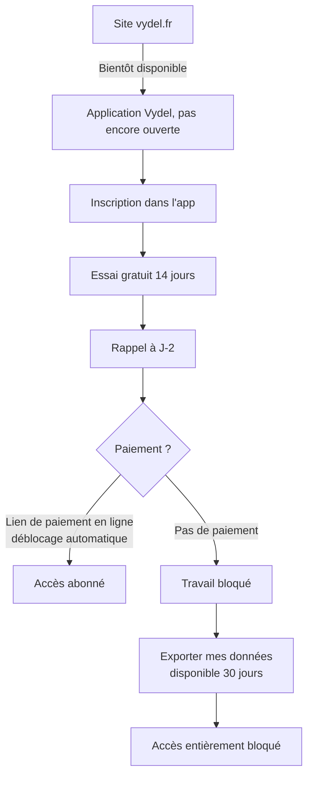

# Vydel — site vitrine (vydel.fr)

Site statique pour GitHub Pages, dépôt `vydel-site`. Ne pas toucher au dépôt d’application déjà en ligne, ni au site utilisateur du même compte, et ne jamais y déclarer le domaine vydel.fr.

L’ancien site a été arrêté par Fabien : ce dossier part de zéro.

Relecture Pepper du 26 novembre 2026 : textes corrigés dans cette copie uniquement. L’original reste dans `/workspace/vydel-site`. Détail des corrections, décisions en attente et commandes (à ne pas lancer) : `NOTES-PREPARATION.md`.

## Tagline retenue

**La tournée, dans l’ordre que tu décides.**

C’est la première option du document de marque, utilisée en haut du site en attendant le choix définitif de Fabien. Alternatives :

1. La tournée, dans l’ordre que tu décides. *(en ligne)*
2. L’app du cabinet IDEL. Pas un dossier médical.
3. Tournée, transmissions, alertes, ordonnances — au même endroit.
4. Ce que le cabinet doit se dire, au même endroit.
5. La tournée se décide à la main. Vydel la partage.

Le site tutoie le lecteur, comme validé.

## Pages

| Fichier | Rôle |
| --- | --- |
| `index.html` | Accueil : hero, problème, fonctions, fonctionnement, aperçu multi-cabinet (« Bientôt »), limites, offre, vie privée, FAQ, CTA |
| `inscription.html` | « Ce qui se passe » — expliquant le parcours d’essai, sans formulaire |
| `essai.html` | Page d’invitation : essai annoncé, bouton « Bientôt disponible » |
| `mentions-legales.html` | Mentions légales (contact : contact@vydel.fr) |
| `confidentialite.html` | Confidentialité relue (faits, sans promesse non vérifiée) |
| `cgu.html` | Conditions d’utilisation (texte complet) |
| `css/styles.css` | Charte (teal, typo système) |
| `js/config.js` | URL de l’app et drapeau d’aperçu multi-cabinet |
| `images/` | Logo PNG, favicons, image Open Graph, aperçus |
| `CNAME` | `vydel.fr` |
| `robots.txt`, `sitemap.xml`, `site.webmanifest`, `.nojekyll` | SEO et GitHub Pages |

Pas de `admin.html` sur ce site. L’outil d’administration reste local, dans l’application, sur l’ordinateur de Fabien. Pas de base de données ni de formulaire d’inscription : les comptes se créent dans l’app.

## Bouton d’essai — « Bientôt disponible »

Les boutons d’essai sont désactivés, non cliquables, et ne pointent vers aucune URL. Le libellé est « Bientôt disponible ».

- L’URL de l’application est conservée en commentaire dans `js/config.js` (`VYDEL_APP_URL`), à brancher plus tard.
- Ne jamais pointer ces boutons vers l’application de production déjà en ligne sur le compte GitHub, ni déclarer le domaine sur le dépôt utilisateur.

## Offre, paiement, fin d’essai

- Essai gratuit de 14 jours, puis 14,99 € par mois pour le cabinet
- Chaque associé paie 14,99 € par mois ; le remplaçant est gratuit
- Règlement via un **lien de paiement en ligne** (ne pas écrire « Revolut » ni « Revolut Business »)
- Accès débloqué **automatiquement** après le paiement
- Fin d’essai : avertissement à **J-2** (pas J-3), puis travail bloqué, « Exporter mes données » pendant 30 jours, ensuite accès entièrement bloqué



## Aperçu multi-cabinet — pas encore en ligne

La section `#apercu-cabinets` de l’accueil est un **aperçu**, libellée « Bientôt ». Le flux « ajouter un cabinet » n’est pas disponible dans l’application actuelle (v1.99.1). Les captures viennent d’une version de test de Pepper, données fictives uniquement (Cabinet des Oliviers, Cabinet du Port).

Drapeau dans `js/config.js` :

```js
window.VYDEL_SHOW_MULTICAB_PREVIEW = true; // false pour masquer la section
```

Laisser la mention « Bientôt » tant que le flux n’est pas réellement publié dans l’app. Ne pas présenter cet aperçu comme une fonctionnalité déjà disponible.

Captures utilisées (dans `images/apercu/`) : étapes 1, 2, 3, 5, 6, 7 et 8.

- **Étape 4 volontairement absente** : le message de confirmation s’affiche en rouge, comme une erreur. L’idée (« le nouveau cabinet est gardé à part, sans rien changer au premier ») est dite dans le texte, sans cette capture. L’original reste dans `/workspace/vydel-site-captures/etape-4.png`, hors site.
- Sur l’étape 5, le bouton « Créer un nouveau cabinet » (visible sous la liste, **non branché**) a été masqué dans la copie `images/apercu/etape-5.png`. Il n’est pas décrit comme une fonctionnalité.

## Vie privée — relue le 26 novembre 2026

Ne jamais écrire « chiffré de bout en bout », « conforme RGPD », « HDS » ou « données jamais transmises ».

La page `confidentialite.html` et l’encadré « Vie privée » de l’accueil ont été complétés au vu de l’audit du 1er octobre 2026 : le site vitrine est statique et sans formulaire ; les données de l’app peuvent transiter par des services tiers ; le PIN ne garantit pas à lui seul la confidentialité ; un retour envoyé depuis l’app peut partir en clair. Aucune déclaration de conformité réglementaire ni d’agrément d’hébergement de données de santé. Vydel n’est pas un dossier médical.

## Mentions légales — champs encore à compléter

Déjà confirmé et écrit :

- « Vydel est édité par Orva Labs, Fabien Lavittola EI — SIRET 10959025700019 » (pied de chaque page, et corps des mentions légales)
- Siège social : 7 impasse du Coulet, 06340 La Trinité
- Contact : contact@vydel.fr

**Encore à décider par Fabien :**

- URL réelle de l’application (`VYDEL_APP_URL` reste en commentaire tant que l’essai n’est pas ouvert)
- Comptes TikTok et Instagram (identifiants proposés à vérifier, dans l’ordre : `vydel`, `vydel.app`, `vydel.idel`, `vydel.officiel`). Les liens ne sont plus affichés tant que les comptes n’existent pas. Pas de Facebook.
- Confirmation de l’hébergeur : mentions GitHub Pages formalisées, sous réserve de la mise en ligne et du feu vert (voir aussi la zone grise des conditions d’usage de Pages, dans `NOTES-PREPARATION.md`)

## Prévisualiser en local

Depuis ce dossier :

```bash
python3 -m http.server 8080
```

Puis ouvrir `http://127.0.0.1:8080/`.

## Activation chez OVH et GitHub Pages

Pepper s’en charge une fois que Fabien a validé le site et lui a donné l’accès à la zone DNS de `vydel.fr` chez OVH. Rien n’est à publier avant ce feu vert.

1. Valider les textes et cette structure, puis ouvrir l’accès OVH à Pepper.
2. Créer un dépôt GitHub **séparé**, par exemple `vydel-site`, et y déposer ce dossier. On n’hérite d’aucun site existant.
3. Activer GitHub Pages **sur ce dépôt** et y déclarer le domaine personnalisé `vydel.fr`. Ce réglage reste sur ce dépôt uniquement.
4. Poser les DNS chez OVH :
   - quatre enregistrements **A** pour `vydel.fr` vers `185.199.108.153`, `185.199.109.153`, `185.199.110.153` et `185.199.111.153`
   - un **CNAME** de `www` vers `mariongomez.github.io`
5. Activer le HTTPS sur GitHub Pages une fois le DNS propagé.
6. Brancher le bouton d’essai sur l’URL réelle de l’app (Pepper).
7. Mettre en ligne seulement après relecture et validation de Fabien.

| Type | Hôte | Cible |
| --- | --- | --- |
| A | vydel.fr | 185.199.108.153 |
| A | vydel.fr | 185.199.109.153 |
| A | vydel.fr | 185.199.110.153 |
| A | vydel.fr | 185.199.111.153 |
| CNAME | www | mariongomez.github.io |

**Ne jamais poser le domaine `vydel.fr` sur le site utilisateur GitHub Pages `mariongomez.github.io`.** Cela redirigerait l’application déjà hébergée sur ce compte. Le domaine personnalisé doit être réglé uniquement sur le dépôt du site vitrine (`vydel-site`).

Le CNAME `www` vers `mariongomez.github.io` est le réglage demandé par Pepper pour GitHub Pages (le dépôt `vydel-site` est sous ce compte). Cela ne signifie pas qu’il faille activer un domaine personnalisé sur le *site utilisateur*.

## Facture

Le modèle de facture n’est pas dans ce dépôt. Il se trouve à part : `/workspace/vydel-facture/facture-modele.html` (et le PDF s’il a été généré).
